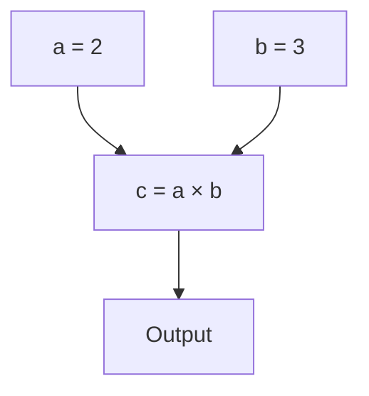
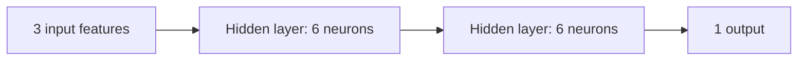

# GradFlow

GradFlow is a small autograd engine and neural network built from scratch in Python. It starts with scalar automatic differentiation and builds up to tensors, neural network layers, and a model trained on real data.

The goal was to understand what happens behind the scenes when a neural network learns: how gradients are calculated, how they move through a computation graph, and how they update a model's weights.


## Why I built this

Most deep learning libraries hide the details of backpropagation behind a few lines of code. I wanted to build those pieces myself and understand how they fit together.

GradFlow follows that process step by step:

- Start with scalar values and their gradients.
- Build a computation graph from mathematical operations.
- Use backpropagation to calculate gradients.
- Extend the scalar engine to tensors.
- Build a multilayer perceptron (MLP).
- Train it on real data.

## Project structure

```text
GradFlow/
├── gradflow/
│   ├── engine.py          # Scalar values and automatic differentiation
│   ├── tensor.py          # Tensor operations
│   └── nn/
│       ├── neuron.py      # Neuron
│       ├── layer.py       # Layer of neurons
│       └── mlp.py         # Multilayer perceptron
├── demo.ipynb             # Training and experiments
├── medical_data.csv       # Breast cancer dataset
├── predict.py             # Prediction from saved weights
└── output_model_weights.json
```

## Values and gradients

Everything starts with `Value`, the scalar object used by the autograd engine.

A `Value` stores:

- `data`: the numerical value.
- `grad`: the gradient of the final result with respect to that value.
- `_prev`: the values that produced it.
- `_op`: the operation that produced it.
- `_backward`: the function that propagates gradients to its inputs.

For example:

```python
a = Value(2.0)
b = Value(3.0)
c = a * b
```

The multiplication creates a new `Value` and records its dependencies. The engine can use that information later to work backward through the calculation.

These relationships form a directed acyclic graph (DAG). Each node represents a value, and each edge represents a dependency between operations.



## Autograd engine

The scalar engine lives in `gradflow/engine.py`.

Each supported operation defines how to calculate its forward value and how to propagate gradients backward.

For multiplication,

$$c = a \cdot b$$

the local derivatives are

$$\frac{\partial c}{\partial a} = b,\qquad\frac{\partial c}{\partial b} = a$$

If the gradient arriving at $c$ is $g$, the inputs receive

$$\frac{\partial L}{\partial a}\mathrel{+}=g \frac{\partial c}{\partial a}= gb$$

$$\frac{\partial L}{\partial b}\mathrel{+}=g \frac{\partial c}{\partial b}= ga$$

The engine uses the same idea for other supported operations, including addition, subtraction, division, and activation functions.

The `backward()` method works roughly like this:

1. Visit the nodes that contribute to the output.
2. Arrange them in topological order so dependencies are processed first.
3. Set the output gradient to `1`, since the derivative of an output with respect to itself is `1`.
4. Traverse the nodes in reverse topological order and run each node's `_backward()` function.

Gradients are accumulated rather than overwritten. This matters when a value contributes to multiple parts of the graph.

## Backpropagation

Backpropagation applies the chain rule repeatedly to calculate how much each input affects the final output.

If $z$ depends on $y$, and $y$ depends on $x$, then

$$\frac{\partial z}{\partial x}=\frac{\partial z}{\partial y}\frac{\partial y}{\partial x}$$

The engine calculates local derivatives for individual operations and combines them as it moves backward through the graph.

For a neural network, the resulting gradients tell us how changing each weight would affect the loss. Training uses those gradients to update the weights in a direction that should reduce the loss.

With gradient descent, a parameter is updated using

$$\theta \leftarrow \theta - \eta \frac{\partial L}{\partial \theta}$$

where $\theta$ is a parameter, $L$ is the loss, and $\eta$ is the learning rate.

## Tensors

Working with scalar values is useful for understanding autograd, but neural networks need vectors and matrices.

`gradflow/tensor.py` builds a tensor abstraction on top of the scalar engine. Tensor elements ultimately use `Value` objects, so tensor operations can use the same gradient calculations.

The tensor implementation supports:

- Element-wise arithmetic.
- Matrix multiplication using `@`.
- Transposition using `T()`.
- Summation using `.sum()`.

For matrices $A$ and $B$, the product $C = AB$ is defined by

$$C_{ij} = \sum_k A_{ik}B_{kj}$$

Each output element is calculated from a row of the first matrix and a column of the second. Because the calculation is built from scalar operations, the autograd engine can track it.

The sum operation reduces a collection of values to a result while preserving the dependencies needed for backpropagation.

## The network

The neural network is built from three components.

**Neuron**

A neuron multiplies its inputs by weights, adds a bias, and passes the result through an activation function:

$$y = f\left(\sum_i w_i x_i + b\right)$$

**Layer**

A layer contains multiple neurons. Each neuron receives the input and produces an output, so the layer returns a collection of activations.

**MLP**

The multilayer perceptron connects layers in sequence. Its parameters are the weights and biases of its neurons, collected so the training loop can calculate gradients and update them.

The classifier uses three input features, two hidden layers with six neurons each, and one output:



The output is used as a score for the binary classification task. The model is small enough to follow without having to navigate a large framework.

## Training

The training loop brings the autograd engine and neural network together.

For each epoch, it:

1. Runs the model on the training data.
2. Calculates the loss by comparing predictions with target labels.
3. Resets parameter gradients with `model.zero_grad()`.
4. Calls `backward()` to calculate gradients.
5. Updates the weights and biases using gradient descent.

The loss function is mean squared error (MSE):

$$L = \frac{1}{N}\sum_{i=1}^{N}(\hat{y}_i-y_i)^2$$

Here, $\hat{y}_i$ is the model's prediction, $y_i$ is the target, and $N$ is the number of examples included in the loss calculation.

The notebook uses batch gradient descent, where gradients are calculated over the training batch before parameters are updated. Weight initialization, the learning rate, and feature normalization all affect training.

The features are normalized using statistics calculated from the training data. The notebook runs training for 500 epochs and splits the dataset into training and test sets to evaluate the model on examples it did not train on.

## Breast cancer classification


The example uses the Wisconsin Breast Cancer Diagnostic dataset. It contains measurements extracted from digitized images of fine needle aspirates (FNA) of breast masses. Each sample has a diagnosis label: benign or malignant.

The model uses three features:

- **Mean radius** — the average distance from the center to points on the cell nucleus perimeter.
- **Mean texture** — variation in grayscale intensity.
- **Mean smoothness** — local variation in radius lengths.

These are a small subset of the measurements available in the original dataset. Using three inputs keeps the example manageable and makes the path from input features to output easier to follow.

Dataset: [UCI Machine Learning Repository — Breast Cancer Wisconsin (Diagnostic)](https://archive.ics.uci.edu/dataset/17/breast+cancer+wisconsin+diagnostic).

This is an educational project, not a clinically validated diagnostic tool. Its predictions should not be used to make medical decisions.

## Running the notebook

Clone the repository:

```bash
git clone https://github.com/pxrxp/GradFlow.git
cd GradFlow
jupyter notebook demo.ipynb
```

Run the notebook cells in order to inspect the data, build the model, train it, and evaluate the results.

## Making predictions

After training, the project saves the model weights and normalization statistics needed to prepare new input data. These are stored in `output_model_weights.json` for use by `predict.py`.

Run the prediction script with:

```bash
python predict.py --radius 15.22 --texture 30.62 --smoothness 0.1048
```

The script loads the saved parameters, applies the same feature normalization used during training, and runs the input through the network.

Example output:

```text
Model loaded from output_model_weights.json

--- GradFlow Diagnosis Report ---
Input Features: Radius=15.22, Texture=30.62, Smoothness=0.1048
Raw Model Score: 0.5831
Diagnosis: MALIGNANT
---------------------------------
```

The output depends on the saved weights and the supplied input. The score is the model's output, not a calibrated probability unless the model and training procedure have been specifically designed and validated for that purpose.

## My notes

I wrote these notes while building GradFlow. They cover the individual parts of the implementation in more detail.

### [The Autograd Engine](theory/01_autograd.md)
`Value`, computation graphs, the chain rule, and topological sorting.

### [Tensor Abstraction](theory/02_tensors.md)
Tensor operations, matrix multiplication, transposition, and reductions.

### [Neural Network Components](theory/03_nn_components.md)
Neurons, layers, and MLPs.

### [Learning Principles](theory/04_learning.md)
Loss functions, gradient descent, learning rates, and normalization.

### [Training Workflow](theory/05_workflow.md)
The training process in `demo.ipynb`.
