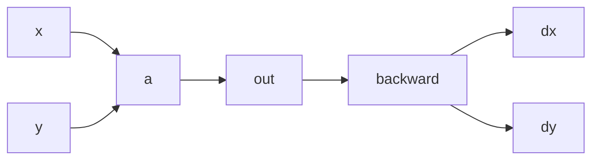
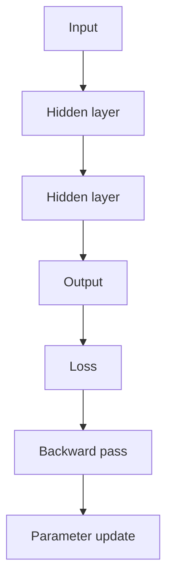

# GradFlow

GradFlow is a small autograd engine and neural network built from scratch in Python.

It starts from a scalar-valued automatic differentiation system and builds up to a simple Multi-Layer Perceptron (MLP). The project is meant to make the internals of deep learning visible: how values are computed, how gradients flow, and how a model learns from data.

## Why this project exists

Modern ML frameworks hide most of the machinery behind abstractions. GradFlow keeps it explicit.

The project is organized around the core ideas behind training a neural network:

- scalar automatic differentiation
- computational graphs
- backpropagation
- gradient descent
- tensor-style operations
- layer-by-layer neural network construction

The aim is not to replace a framework. It is to understand the mechanics behind one.

## Project structure

- [gradflow/engine.py](gradflow/engine.py) — scalar autograd engine
- [gradflow/tensor.py](gradflow/tensor.py) — tensor abstraction for higher-dimensional operations
- [gradflow/nn/](gradflow/nn/) — neural network building blocks
- [demo.ipynb](demo.ipynb) — training and evaluation notebook
- [predict.py](predict.py) — prediction script using saved model weights
- [output_model_weights.json](output_model_weights.json) — trained weights and normalization values
- [THEORY.md](THEORY.md) — deeper notes on the math and implementation

## Core idea: values and gradients

The fundamental object is a scalar `Value`.

Each value stores:

- its numerical value
- its gradient
- the operation that created it
- references to its inputs

This gives every computation a dependency graph.



If we compute:

$z = x \cdot y$

then the result knows it came from `x` and `y`, and it also knows:

$\frac{\partial z}{\partial x} = y, \quad \frac{\partial z}{\partial y} = x$

This is the basic mechanism behind automatic differentiation.

## Backpropagation

The forward pass computes values. The backward pass propagates gradients from the loss back through the graph.

For a scalar loss $L$ and parameter $\theta$:

$\theta \leftarrow \theta - \eta \frac{\partial L}{\partial \theta}$

This is gradient descent, and it is the core of training.

The project makes this explicit by building a topological ordering of the computation graph and traversing it in reverse.

## Scalar engine

The scalar engine is the foundation.

It implements:

- addition, multiplication, subtraction, division
- activation functions
- local derivative tracking
- recursive backward traversal
- topological ordering

This is the minimal machinery needed for autodiff. It is intentionally simple enough to read through and reason about.

## Tensor abstraction

The scalar engine handles single numbers well, but neural networks operate on vectors and matrices.

The tensor layer bridges that gap by wrapping higher-dimensional data and routing operations back into scalar computations. It supports:

- element-wise arithmetic
- matrix multiplication
- transposition
- reductions like `.sum()`

This is where the scalar autograd logic meets the structure of a neural network.

## Neural network modules

The project then builds the usual components of a small network:

- `Neuron`
- `Layer`
- `MLP`

A neuron computes something like:

$y = \sigma(w^\top x + b)$

where $w$ is the weight vector, $b$ is the bias, and $\sigma$ is the activation function.

The network is assembled explicitly rather than hidden behind a framework. This makes the flow of data and gradients much easier to follow.



## Example: breast cancer diagnosis

The repository includes a practical classification task using the Wisconsin Breast Cancer Diagnostic dataset.

The model uses clinical features such as:

- radius mean
- texture mean
- smoothness mean

and predicts whether a sample is malignant or benign.

This keeps the project grounded in a real problem while still staying small and understandable.

## Dataset

The dataset contains 569 samples derived from image-based measurements of breast masses. The features summarize properties of cell nuclei, and the target label indicates the diagnosis.

## Training workflow

The notebook demonstrates the complete flow:

1. load data
2. preprocess inputs
3. build the network
4. compute the forward pass
5. evaluate the loss
6. backpropagate
7. update parameters
8. inspect the result

This is the actual training loop, written in a form that is easy to read.

## Running the notebook

```bash
jupyter notebook demo.ipynb
```

## Quick prediction

A saved model can also be used directly from the command line:

```bash
python predict.py --radius 15.22 --texture 30.62 --smoothness 0.1048
```

Example output:

```text
Model loaded from output_model_weights.json

--- GradFlow Diagnosis Report ---
Input Features: Radius=15.22, Texture=30.62, Smoothness=0.1048
Raw Model Score: 0.5831
Diagnosis: MALIGNANT
---------------------------------
```

## Theory and notes

The mathematics behind the implementation is collected in [THEORY.md](THEORY.md). It covers the derivations and training logic in more detail and is intended as a companion to the code.

This project is best understood as a study in the internals of machine learning: not the polished surface, but the actual mechanics underneath it.

## Summary

GradFlow is a compact implementation of the core ideas behind modern ML:

- autodiff
- graph-based backpropagation
- tensor operations
- neural network construction
- gradient descent

It is small, readable, and built to be understood.
